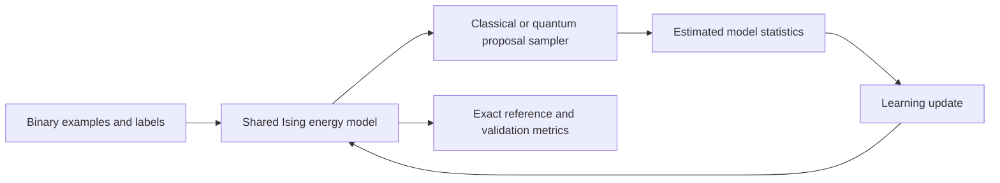

# QEMCMC and Ising Energy-Based Models

A standalone research repository for **quantum-enhanced Markov chain Monte Carlo (QEMCMC)** and its use in training Ising energy-based models. It includes classical sampling controls, exact references, adaptive proposal selection, persistent chains, CPU/GPU implementations, and completed experiment records.

The central question is whether quantum-generated proposals produce more accurate sampling estimates for the model's learning updates under matched proposal budgets. The experiments also separate the effects of **adaptation**—changing proposal settings—from **persistence**—carrying chains forward between updates.

**Current finding:** the simulator results support a sampling/gradient-accuracy finding, with persistence explaining most Stage-2 improvement. They do not establish hardware speedup, quantum advantage, or superior crop classification.

## How the experiment works

An energy-based model assigns an energy to a configuration of binary spins and a class label. Learning requires statistics from both the observed data and the model's own distribution. The latter, often called the **negative phase**, is where the sampler enters the experiment.



QEMCMC simulates quantum evolution to form a proposal distribution over spin configurations. The sampling procedure applies an acceptance step to those proposals. The CPU implementation uses sparse numerical evolution; the GPU implementation uses a double-precision Chebyshev expansion. Both are classical simulations of the quantum proposal mechanism, not executions on a quantum processor.

The same energy-model implementation is compared with different samplers. This keeps the learning problem shared while changing how the model statistics are estimated.

## Methods and evaluation

| Method family | Role in the study |
| --- | --- |
| Gibbs, local Metropolis-Hastings, uniform Metropolis-Hastings | Classical sampling controls. |
| Persistent contrastive divergence (`pcd`) | Classical control that retains chain state across updates. |
| Parallel tempering (`pt`) | Classical multi-temperature sampling control. |
| QEMCMC (`qemcmc`) | Quantum-generated proposals with the registered fixed settings. |
| Persistent QEMCMC (`qemcmc-p`) | Tests the contribution of chain persistence. |
| Adaptive QEMCMC variants | Select among proposal settings, with persistent and nonpersistent variants. |
| Exact enumeration (`exact`) | Reference statistics and an exact-update comparator at tractable widths. |

The adaptive variants distinguish an exact-error reward from a proxy based on accepted Hamming jumps. These answer different questions: an exact-reference reward uses information that may be unavailable at larger scales. The [Stage-2 preregistration](docs/protocols/STAGE2_ADAPTIVE_PREREG.md) defines the comparisons.

Recorded measures include gradient-estimation error, total variation distance, autocorrelation/effective sample size, mode coverage, and exact negative log-likelihood. Classification metrics are reported separately. Equal proposal counts do not imply equal wall-clock cost; consult the timing and numerical-validation records before drawing efficiency conclusions.

## Completed studies

| Study | Included results | Read next |
| --- | --- | --- |
| Stage 1 | 84 runs: four dataset levels × seven samplers × three seeds. | [Sampler report](results/SAMPLER_REPORT.md) |
| Stage 2 | 60 runs plus a reproduction guard, separating adaptation and persistence. | [Adaptive report](results/ADAPTIVE_REPORT.md) |
| Scaling ladder | 18 runs at 22 bits, following the 20-bit study. | [Ladder report](results/LADDER_REPORT.md) |
| 24-bit extension | Code/protocol support exists; no completed result artifacts are included. | [Scaling preregistration](docs/protocols/SCALING_LADDER_PREREG.md) |

The levels include a planted Ising control (A), easy/hard synthetic binary controls (B), and frozen crop-image-derived binary codes (C). Results from these different levels should be interpreted within their own protocols.

The saved reports are the scientific record. The checks below establish that selected code paths work; they do not reproduce the full experiment grid.

## CPU quick start: no images or GPU required

Use Windows PowerShell and Python 3.10 for the pinned CPU environment:

```powershell
git clone https://github.com/Shafin-paranoid-Ahmed/qemcmc.git
Set-Location qemcmc
py -3.10 -m venv .venv
& .\.venv\Scripts\python.exe -m pip install -r requirements.txt
& .\.venv\Scripts\python.exe scripts/run_tests.py
& .\.venv\Scripts\python.exe scripts/smoke_test.py
```

If you already have the checkout, start from its root and skip cloning. Environment activation is optional because the commands call its interpreter directly.

The CPU runner explicitly selects the **14 CPU unit tests**, avoiding imports of the optional GPU backend. The smoke check verifies frozen split loading, agreement between direct and subprocess metrics, and a normalized four-spin quantum proposal. Neither command launches the historical grid or regenerates image features.

Use [requirements.txt](requirements.txt) for the core NumPy/SciPy/scikit-learn stack. Extraction verification used an existing environment; fresh dependency installation and other operating systems were not tested. Full details are in [VALIDATION.md](VALIDATION.md).

## Data and optional image-code generation

Historical binary-code tables are included in `results/`, so they can be inspected and used by the EBM code without downloading raw images. The seed 0/1/2 manifests in [splits/](splits/) preserve the original crop task. The metric implementation and manifests are stored locally: there is no runtime dependency on the QCNN or thesis repository.

Regenerating Level-C codes requires the original Dacon crop dataset and the optional image dependencies:

```powershell
& .\.venv\Scripts\python.exe -m pip install -r requirements-images.txt
$env:QEMCMC_DATA_ROOT = 'D:\datasets\dacon'
& .\.venv\Scripts\python.exe scripts/build_codes.py --help
```

`QEMCMC_DATA_ROOT` must contain `test/<image-id>/<image-id>.jpg`. Its default is this repository's `data/` directory. Raw images and pretrained ResNet weights are not bundled; torchvision may download weights on the first extraction run.

The Level-C pipeline uses a **frozen pretrained ResNet-18**, followed by PCA and binary-code construction. PCA is fitted on each seed's training partition. Preserve the frozen manifests and the registered code-generation settings when reproducing results; do not replace existing code tables casually.

## Optional GPU environment

The GPU backend has a separate dependency record, [requirements-gpu.txt](requirements-gpu.txt). The small extraction check passed with **Python 3.12.10, CuPy 14.1.1, and CUDA 13 packages**. A compatible NVIDIA driver and the matching runtime/compiler dependencies are required. These are observed working versions, not a freshly tested installation recipe.

| Setting | Purpose | Default |
| --- | --- | --- |
| `QEMCMC_DATA_ROOT` | Raw-image root for optional feature extraction. | Repository `data/` |
| `QEMCMC_METRICS_PYTHON` | CPU interpreter used by the classification-metric subprocess. | Running interpreter |
| `CUPY_CACHE_DIR` | Compiled GPU-kernel cache for GPU scripts that set it. | Repository `.cache/cupy` |

When using the separate GPU environment, point the metric bridge at the pinned CPU environment:

```powershell
$env:QEMCMC_METRICS_PYTHON = (Resolve-Path '.\.venv\Scripts\python.exe').Path
& .\.venv-gpu\Scripts\python.exe scripts/gpu_bench/test_gpu_proposal.py
```

This assumes `.venv-gpu` has already been created and configured. The command runs the small four-spin dense-reference comparison. The full numerical-acceptance matrix in [the runbook](RUN_COMMANDS.md) is a separate prerequisite for claiming GPU reproduction on another machine.

## Running and resuming experiments

Inspect the trainer's arguments without launching a run:

```powershell
& .\.venv\Scripts\python.exe scripts/stage1_train.py --help
```

Runs specify a dataset level, sampler, seed, update count, chain count, proposal-step budget, artifact tag, backend, and bit width. The [current runbook](RUN_COMMANDS.md) links to the preserved registered command blocks. Keep their scientific budgets intact when reproducing a comparison.

The trainer stores history, metadata, and resume state under `results/`. Resume state includes model parameters, optimizer state, chains, and random-number-generator state; adaptive runs also preserve the controller. Restart an interrupted run with the same budget flags. The implementation rejects incompatible resume budgets and guards repeated final-test evaluation.

Large state spaces and exact references can be expensive. Use a disposable reproduction checkout so full runs and aggregation scripts do not disturb the published result files. Historical G:/F: machine paths in archived commands are provenance, not required local paths.

## Repository guide

| Path | What to find there |
| --- | --- |
| [scripts/qemcmc.py](scripts/qemcmc.py) | CPU quantum proposal and reference instances. |
| [scripts/exact.py](scripts/exact.py) | Exact spin enumeration and reference statistics. |
| [scripts/stage1_train.py](scripts/stage1_train.py) | Shared EBM, sampler comparisons, metrics, and resume handling. |
| [scripts/adaptive_controller.py](scripts/adaptive_controller.py) | Adaptive proposal-setting controller. |
| [scripts/build_codes.py](scripts/build_codes.py) | Frozen image encoder and binary-code preparation. |
| [scripts/gpu_bench/](scripts/gpu_bench/) | GPU proposal/reference implementations and numerical checks. |
| [scripts/metrics.py](scripts/metrics.py) | Preserved classification metrics. |
| [scripts/metrics_bridge.py](scripts/metrics_bridge.py) | Subprocess bridge for a separate metric environment. |
| [splits/](splits/) and [results/](results/) | Frozen manifests, code tables, histories, and reports. |
| [docs/protocols/](docs/protocols/) | Stage 1, adaptive, and scaling preregistrations. |

## Provenance and validation

This is a clean standalone snapshot of the original thesis study. Historical result metadata preserves the source machines and commits; extraction did not recompute scientific results.

- [PROVENANCE.md](PROVENANCE.md) and [SOURCE_MANIFEST.json](SOURCE_MANIFEST.json): source attribution, extraction changes, and file hashes.
- [VALIDATION.md](VALIDATION.md): 14 passing CPU tests, synthetic checks, the four-spin GPU comparison, and fresh GitHub clone verification. Full training and the full GPU acceptance matrix were not rerun.
- [EXTRACTION_CHECKLIST.md](EXTRACTION_CHECKLIST.md): completed separation/publication checklist.
- [NOTICE.md](NOTICE.md): contributor credit and licensing status; extraction did not introduce a new redistribution license.
